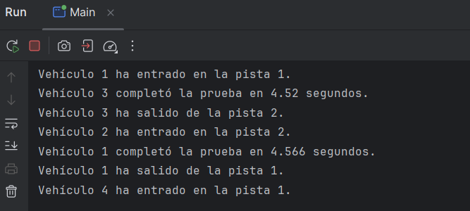

# Caso práctico 4: Programación multihilo

## Descripción

Banco de pruebas de vehículos con acceso limitado a pistas. Hay 4 vehículos (hebras) y solo 2 pistas, y cada pista solo puede ser ocupada por un vehículo a la vez. Si las dos pistas están ocupadas, el vehículo espera hasta que una se libere.

## Estructura del proyecto

- `Pistas.java`: recurso compartido. Tiene un array de booleanos `disponibles` (true = libre) y los métodos `ocupar()` y `liberar()`.
- `Vehiculo.java`: hebra que representa a un vehículo. Ocupa una pista, hace la prueba durante un tiempo aleatorio (2 a 5 segundos) y la libera.
- `Main.java`: crea una única instancia de `Pistas` con 2 pistas, crea los 4 vehículos, los lanza y espera a que terminen con `join()`.

## Funcionamiento

1. Cada vehículo llama a `ocupar()`. Si hay una pista libre, la marca como ocupada y devuelve su número.
2. Si no hay ninguna libre, el vehículo se queda esperando con `wait()`.
3. El vehículo hace la prueba (`Thread.sleep` con un tiempo aleatorio entre 2000 y 5000 ms) y muestra cuánto ha tardado.
4. Al terminar llama a `liberar()`, que marca la pista como libre y despierta a los vehículos que esperan con `notifyAll()`.

## Sincronización

- Los métodos `ocupar()` y `liberar()` son `synchronized`, de modo que solo una hebra a la vez puede consultar o modificar el array. Esto asegura la **exclusión mutua** y evita condiciones de carrera (por ejemplo, que dos vehículos cojan la misma pista).
- `wait()` hace que el vehículo espere cuando no hay pistas libres, y libera el bloqueo del objeto mientras espera para que otro vehículo pueda liberar una pista.
- `notifyAll()` se llama al liberar una pista para avisar a los vehículos que esperan.
- La comprobación de pista libre se hace con un `while` y no con un `if`, para volver a comprobar la condición cada vez que la hebra se despierta.
- Como máximo hay dos vehículos probando a la vez, porque solo existen dos posiciones en el array.

## Resultado

En la consola se ve cómo entran dos vehículos al principio, los otros dos esperan, y cada vez que uno sale entra otro en la pista que ha quedado libre. Los 4 vehículos completan la prueba.